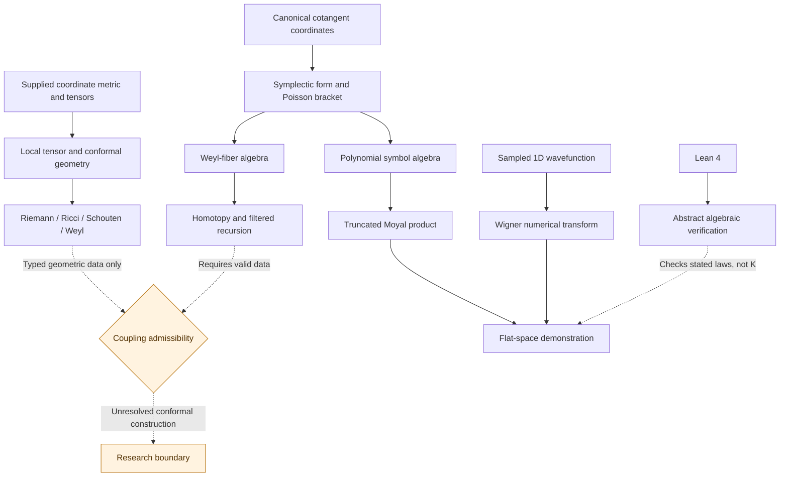
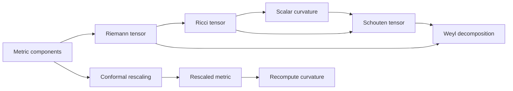
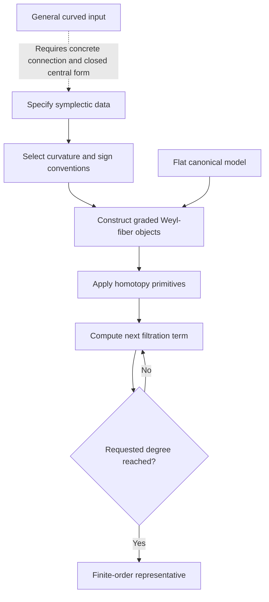
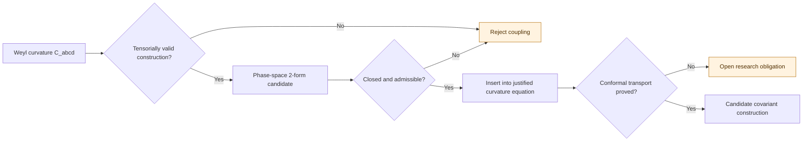
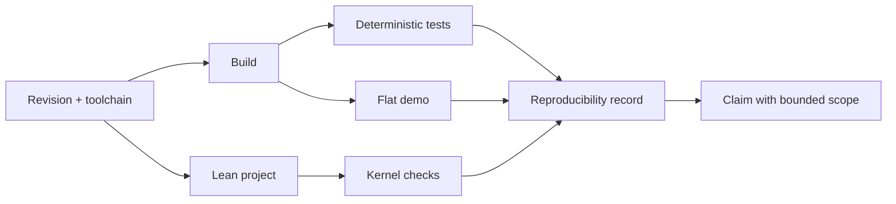

# Conformal Weyl–Fedosov Deformation Architecture

[](https://www.gnu.org/licenses/agpl-3.0)
[](https://github.com/AHMADALIPARR/geometric-weyl-transformer)
[](https://github.com/AHMADALIPARR/geometric-weyl-transformer/commits/main)
[](https://github.com/AHMADALIPARR/geometric-weyl-transformer/actions/workflows/ci.yml)

**Differential Geometry · Conformal Curvature · Symplectic Geometry · Deformation Quantization · Formal Verification**

Haskell + Lean 4 research implementation, with symbolic polynomial and numerical backends.

> **Scope.** A buildable computational foundation and research scaffold for a twelve-module architecture. The implemented flat-space and polynomial models are distinguished throughout from the unresolved curved, conformally covariant deformation problem.

## Custom project setup

This is a custom project: Haskell (Cabal) plus Lean 4 (Lake), with no Python, no external computer algebra system, and no network service at runtime. The Lean side is dependency-free by design.

### Lean project

The Lean project lives in `lean/` and is defined by two files:

- `lean/lakefile.lean` — `open Lake DSL`, `package «cwf» where version := v!"0.1.0"`, and `lean_lib CWF`. Zero dependencies are declared.
- `lean/lean-toolchain` — pins `leanprover/lean4:v4.19.0`.

The CWF library is self-contained. `lean/CWF/Algebra.lean` carries zero import lines: lines 1–16 are the AGPL-3.0 copyright header, line 18 opens `namespace CWF`, and lines 20–42 define `AssocAlgebra`, the `⋆` infix operator, and prove `star_assoc`, `star_left_unit`, and `star_right_unit` using only Lean 4's built-in core prelude. No Mathlib, no external Lean packages.

Build the Lean library with the library target, not a bare `lake build` (which only compiles the lakefile itself):

```bash
cd lean
lake build CWF
```

Files under `lean/` that import Mathlib (for example `ConfigurationProof.lean` and `DeformationQuantization.lean`) are **not** part of the CWF library build — `lean/CWF.lean` imports only `CWF.Algebra`, `CWF.Conformal`, `CWF.Symplectic`, and `CWF.Fedosov` — so they are not built by `lake build CWF`.


<p align="center">
  
</p>

<p align="center"><sub>Historical context: Hermann Weyl. Photograph from ETH-Bibliothek, via Wikimedia Commons; see the <a href="https://commons.wikimedia.org/wiki/File:Hermann_Weyl_ETH-Bib_Portr_00890.jpg">source and license record</a>. The portrait illustrates mathematical history, not evidence for the proposed coupling.</sub></p>

---

## Table of Contents

- [Custom project setup](#custom-project-setup)
1. [Technical Overview](#1-technical-overview)
2. [Status and Mathematical Boundary](#2-status-and-mathematical-boundary)
3. [System Architecture](#3-system-architecture)
4. [Repository Layout](#4-repository-layout)
5. [Mathematical Conventions](#5-mathematical-conventions)
6. [Conformal Tensor Geometry](#6-conformal-tensor-geometry)
7. [Cotangent Symplectic Geometry](#7-cotangent-symplectic-geometry)
8. [Polynomial Symbols and Moyal Product](#8-polynomial-symbols-and-moyal-product)
9. [Weyl Fibers and Fedosov Recursion](#9-weyl-fibers-and-fedosov-recursion)
10. [Conformal Coupling Research Boundary](#10-conformal-coupling-research-boundary)
11. [Wigner Transform and Numerical Backend](#11-wigner-transform-and-numerical-backend)
12. [Lean 4 Verification](#12-lean-4-verification)
13. [Formal Interface and Dataflow](#13-formal-interface-and-dataflow)
14. [Build and Dependencies](#14-build-and-dependencies)
15. [Testing and Reproducibility](#15-testing-and-reproducibility)
16. [Research Obligations](#16-research-obligations)
17. [Visual Reference and Attribution](#17-visual-reference-and-attribution)
18. [Terminology and Scope](#18-terminology-and-scope)

---

## 1. Technical Overview

This project studies the interface between conformal curvature constructions and formal deformation quantization. Its computational architecture separates local tensor operations, canonical phase-space geometry, formal associative products, recursive Fedosov-style machinery, sampled phase-space transforms, and machine-checked abstract algebra.

The design is deliberately layered: results verified for polynomial symbols on flat canonical phase space are useful on their own, but do **not** imply the existence of a general conformally covariant Weyl-curvature-coupled star product.

| Layer | Mathematical object | Computation | Boundary |
|---|---|---|---|
| Tensor geometry | $g_{ab}$, curvature tensors | Coordinate components and conformal rescaling | Requires supplied coordinates and conventions |
| Conformal geometry | Schouten and Weyl decomposition | Finite-dimensional local algebra | Covariance of a full Fedosov construction remains unproved |
| Symplectic geometry | $(T^*M,\omega)$ | Canonical form and Poisson brackets | Cotangent-bundle model |
| Symbol algebra | Polynomial functions on phase space | Finite formal-$\hbar$ series | Truncated at configured order |
| Flat deformation | Moyal product | Exact polynomial-symbol computation through chosen order | Flat canonical model |
| Fedosov machinery | Weyl fibers, homotopy, filtration | Typed recursive interface and flat model | General curved connection data must be supplied |
| Phase-space numerics | Wigner transform | Sampled 1D wavefunctions | Numerical sampling assumptions apply |
| Formal verification | Lean propositions and algebraic laws | Proof checking | Only statements present in Lean artifacts are proven |

### Central engineering principle

**Typed boundaries precede geometric coupling.** Each algebraic layer exposes its assumptions before data passes into the next layer. A curvature tensor cannot become a central phase-space two-form merely by renaming or reshaping its indices.

## 2. Status and Mathematical Boundary

### Implemented foundations

- Finite-dimensional local tensor algebra and conformal rescaling.
- Riemann, Ricci, Schouten, and Weyl decomposition for supplied coordinate tensors.
- Canonical cotangent symplectic structure and Poisson brackets.
- Polynomial symbols, formal-$\hbar$ series, and truncated Moyal multiplication.
- Fedosov Weyl-fiber algebra, homotopy primitives, filtration-ordered recursive solver interface, and a flat-model implementation.
- Wigner transforms for sampled one-dimensional wavefunctions.
- Lean proofs of abstract algebraic laws that do not assume the unresolved geometric construction.

### Explicitly unresolved

A nontrivial Weyl-curvature-coupled Fedosov product that is simultaneously conformally covariant has **not** been constructed or proved in this repository. In particular, an untyped insertion of $C_{abcd}$ into a central two-form is rejected by design. A candidate must first define a tensorially meaningful, closed phase-space two-form or justify an alternative curvature equation, and then establish an appropriate conformal transport law.

| Statement | Scope | Evidence category |
|---|---|---|
| Polynomial Moyal multiplication | Finite polynomial symbols, bounded formal order | Implemented algebra |
| General Fedosov recursion | Typed and filtration-aware interface | Interface plus flat model |
| Curved symplectic Fedosov data | Requires connection, curvature convention, central form | Research integration task |
| Abstract Lean algebraic laws | As defined by individual Lean declarations | Machine-checked proofs |
| Curvature-coupled conformal star product | General construction | **Open research obligation** |

> Formal-order truncation is a computational quotient. It does not prove that omitted higher-order terms vanish in an untruncated deformation.

## 3. System Architecture



### Dependency separation

| Producer | Consumer | Transferred information | Required discipline |
|---|---|---|---|
| Tensor geometry | Coupling research layer | Geometric tensors and conventions | Tensor type and index handling |
| Symplectic geometry | Symbol algebra | Coordinates and canonical bracket | Consistent coordinate ordering |
| Polynomial engine | Moyal multiplication | Finite polynomial and formal coefficients | Explicit $\hbar$ order |
| Weyl-fiber primitives | Recursive solver | Graded fiber terms | Filtration ordering |
| Wavefunction sampler | Wigner transform | Samples and spacing | Numerical normalization and resolution |
| Mathematical definitions | Lean proof layer | Formal statements | Proofs apply to represented assumptions only |

## 4. Repository Layout

The user-provided repository description identifies the following verified top-level locations. Individual filenames inside the twelve-module directory are not enumerated here because their contents were not supplied.

```text
.
├── app/
│   └── Main.hs                  # symbolic / numeric flat-space demo
├── src/
│   └── ConformalWeyl/          # twelve-module implementation
├── test/
│   └── Spec.hs                  # deterministic tests
├── lean/                        # Lean 4 definitions and proofs
└── docs/
    └── RESEARCH_BOUNDARIES.md   # established results vs obligations
```

| Path | Role | Expected reader |
|---|---|---|
| `src/ConformalWeyl/` | Research implementation modules | Geometry and algebra developers |
| `app/Main.hs` | Flat-space demonstration entry point | New users and maintainers |
| `test/Spec.hs` | Deterministic test suite | Contributors and reviewers |
| `lean/` | Formal definitions and proofs | Formal-methods reviewers |
| `docs/RESEARCH_BOUNDARIES.md` | Scientific claim and proof boundary | Researchers and auditors |

**Inventory policy:** inspect `src/ConformalWeyl/` before documenting exact names or assigning each of the twelve modules a specific responsibility. The table above is not a replacement for a file-level inventory.

## 5. Mathematical Conventions

Local canonical cotangent coordinates are ordered as

$$
(x^1,\ldots,x^n,p_1,\ldots,p_n)\quad\text{on }T^*M.
$$

The canonical symplectic form and associated Poisson bracket use the conventions

$$
\omega=\sum_{i=1}^{n}dx^i\wedge dp_i,
$$

$$
\{f,g\}=\sum_{i=1}^{n}
\left(\frac{\partial f}{\partial x^i}\frac{\partial g}{\partial p_i}
-\frac{\partial f}{\partial p_i}\frac{\partial g}{\partial x^i}\right).
$$

| Symbol | Meaning |
|---|---|
| $M$ | Base manifold |
| $T^*M$ | Cotangent bundle / canonical phase space |
| $g_{ab}$ | Metric tensor in supplied coordinates |
| $C_{abcd}$ | Weyl curvature tensor |
| $\omega$ | Canonical symplectic two-form |
| $\{f,g\}$ | Poisson bracket |
| $\hbar$ | Formal deformation parameter |
| `hbarOrder` | Highest retained formal power in the computational quotient |

Curvature sign and index ordering must follow the implementation's `Curvature.hs` convention; the abbreviated formulas below are explanatory and do not supersede that source convention.

## 6. Conformal Tensor Geometry

The tensor layer supplies curvature-related operations for coordinate data. It distinguishes the Riemann tensor, its Ricci contraction, the Schouten tensor, and the traceless Weyl contribution.

For dimension $n\geq 3$, one common Schouten convention is

$$
P_{ab}=\frac{1}{n-2}\left(R_{ab}-\frac{R}{2(n-1)}g_{ab}\right).
$$

A corresponding curvature decomposition is expressed schematically as

$$
R_{abcd}=C_{abcd}+(g\owedge P)_{abcd},
$$

where $\owedge$ is the Kulkarni–Nomizu product. Index positions and the overall Riemann sign depend on the adopted curvature convention.

### Conformal transformation input

A conformal rescaling takes

$$
\widehat g_{ab}=e^{2\varphi}g_{ab}.
$$

The geometry layer can inspect transformations at the coordinate-tensor level. That alone does not establish how a Fedosov flat connection or star product should transform.



## 7. Cotangent Symplectic Geometry

Canonical phase space supplies the base geometric structure used by Poisson and deformation-quantization operations. Its two-form is closed, $d\omega=0$, and nondegenerate in canonical coordinates.

```text
             COTANGENT PHASE SPACE T*M

       Base coordinates                 Fiber coordinates
       x¹  x²  ...  xⁿ                  p₁  p₂  ...  pₙ
        │   │        │                    │   │        │
        └───┴────────┴───────┬────────────┴───┴────────┘
                            │
                    ω = Σ dxⁱ ∧ dpᵢ
                            │
                     Poisson bracket
                            │
                 Polynomial observables
```

### Canonical consistency checks

| Relation | Expected result |
|---|---|
| $\{x^i,x^j\}$ | $0$ |
| $\{p_i,p_j\}$ | $0$ |
| $\{x^i,p_j\}$ | $\delta^i_j$ |
| $\{f,g\}+\{g,f\}$ | $0$ |
| $\{f,gh\}$ | $\{f,g\}h+g\{f,h\}$ |

These identities are natural verification targets. Their appearance in this table does not assert that each has a corresponding Lean theorem unless one is present in `lean/`.

## 8. Polynomial Symbols and Moyal Product

The symbolic algebra represents polynomial functions on canonical phase space and formal power series in $\hbar$, truncated at the selected computational order.

Under a standard convention, the flat-space Moyal product is

$$
f\star g
=f\exp\!\left[\frac{i\hbar}{2}
\left(\overleftarrow\partial_{x^i}\overrightarrow\partial_{p_i}
-\overleftarrow\partial_{p_i}\overrightarrow\partial_{x^i}\right)\right]g.
$$

Repeated indices are summed. The choice between complex quantum conventions and purely formal real-parameter conventions must follow the concrete backend.

To first order,

$$
f\star g=fg+\frac{i\hbar}{2}\{f,g\}+O(\hbar^2).
$$

### Representation model

```text
    SYMBOL f(x,p)          SYMBOL g(x,p)
          │                     │
          ▼                     ▼
    polynomial AST        polynomial AST
          └──────────┬──────────┘
                     ▼
            bidifferential terms
                     │
                     ▼
         collect by ħ power and monomial
                     │
                     ▼
           truncate to hbarOrder
                     │
                     ▼
          finite formal product f ★ g
```

| Property | Meaning | Scope |
|---|---|---|
| Finite representation | Each polynomial has finitely many monomials | Symbol backend |
| Formal order | Coefficients collected by $\hbar$ degree | Series backend |
| Polynomial exactness | Polynomial symbolic operations avoid floating approximation when coefficient domains permit | Chosen finite order |
| Truncation | Terms above `hbarOrder` are dropped | Quotient computation |
| Associativity | Meaningful modulo the same formal-order quotient | Requires appropriately implemented product |

## 9. Weyl Fibers and Fedosov Recursion

The Fedosov layer supplies fiber algebra, graded homotopy primitives, and a filtration-ordered recursive solver interface. Its implemented flat-model path is separate from the general curved construction.

In a conventional Fedosov presentation, fiber coordinates $y^i$ and a formal Weyl product accompany differential forms, a symplectic connection, and a correction one-form. A frequently used schematic connection form is


D=-\delta+\nabla+\frac{1}{\hbar}\operatorname{ad}_{\circ}(r),


with convention-dependent factors of $i$, signs, and curvature terms. This is **background mathematical structure**, not an assertion that all ingredients of a global curved model have been supplied here.

### Recursive control flow



| Requirement | Why it matters | Repository status described |
|---|---|---|
| Graded fiber algebra | Local formal multiplication | Implemented |
| Homotopy primitives | Recursive inversion mechanism on suitable graded components | Implemented |
| Filtration ordering | Deterministic finite-order construction | Interface implemented |
| Flat-model solver | Demonstrable canonical case | Implemented |
| Curved symplectic connection | Covariant differentiation and curvature | Must be concretely supplied |
| Closed central two-form | Fedosov curvature input | Must be concretely supplied |

## 10. Conformal Coupling Research Boundary

### Why a type barrier exists

A four-index base-manifold Weyl tensor $C_{abcd}$ and a two-form on phase space are different geometric objects. The latter has phase-space form degree two, requires specified contraction or pullback operations, and—if used as central Fedosov curvature data—must meet the relevant closedness condition.



### Research acceptance conditions

| Gate | Necessary demonstration |
|---|---|
| Tensorial construction | A coordinate-independent mapping from permitted geometric inputs |
| Correct degree | A genuine phase-space differential two-form or justified alternative |
| Closedness | $d\Omega=0$ where the Fedosov formulation requires it |
| Curvature compatibility | Well-defined symplectic connection and curvature equation |
| Associativity | Proof of the induced product under stated hypotheses |
| Conformal covariance | Defined transformation or equivalence law under $g\mapsto e^{2\varphi}g$ |
| Nontriviality | Coupling is demonstrably more than a vacuous zero or relabeling |
| Formal verification | Theorems match implemented algebraic objects and assumptions |

Passing a syntactic type check does not imply that all geometric obligations have been discharged.

## 11. Wigner Transform and Numerical Backend

For a one-dimensional wavefunction, a common Wigner-transform convention is

$$
W_\psi(x,p)=\frac{1}{2\pi\hbar}\int_{-\infty}^{\infty}
 e^{-ipy/\hbar}\psi\left(x+\frac y2\right)
 \overline{\psi\left(x-\frac y2\right)}\,dy.
$$

The repository includes a Wigner transform for sampled one-dimensional wavefunctions. The equation above fixes an explanatory convention; numerical normalization, sampling intervals, finite boundaries, and transform sign must be checked against the implemented routine.

| Numerical concern | Interpretation | Reproducibility consideration |
|---|---|---|
| Grid spacing | Resolution in coordinate space | Record $\Delta x$ |
| Momentum sampling | Dual discretization | Record momentum grid convention |
| Boundary treatment | Finite sampled domain | Specify truncation/window assumptions |
| Normalization | Wavefunction and transform scaling | Compare stated identities under discrete convention |
| Precision | Floating-point arithmetic | Record compiler and numeric backend |

### Dataflow

```text
       sampled ψ(x)
            │
            ▼
   displaced pair samples
 ψ(x + y/2), ψ*(x - y/2)
            │
            ▼
     complex correlation
            │
            ▼
   Fourier transform in y
            │
            ▼
       Wigner W(x,p)
            │
            ▼
       numeric inspection
```

## 12. Lean 4 Verification

The Lean directory contains definitions and proofs of abstract algebraic laws that can be shown independently of the unresolved geometric coupling. A checked proof has force only for the exact definitions and hypotheses appearing in its theorem statement.

The CWF library (`lean/CWF.lean`, `lean/CWF/`) is self-contained and dependency-free; see [Custom project setup](#custom-project-setup). `lean/CWF/Algebra.lean` has zero import lines and uses only Lean 4's core prelude.

### Proof coverage matrix

| Verification domain | Appropriate theorem form | Evidentiary boundary |
|---|---|---|
| Basic algebra | Identity, closure, or distributive laws | As encoded in Lean |
| Poisson-level structure | Antisymmetry, Leibniz, Jacobi where formalized | Requires corresponding definitions |
| Formal truncated algebra | Equality modulo chosen $\hbar$ order | Finite-order claim only |
| Recursive solver | Filtration preservation / well-foundedness when proved | Depends on actual solver model |
| Conformal Fedosov covariance | Geometric transformation theorem | **Not established by abstract algebraic proofs** |

### Review procedure

1. Open the actual declarations in `lean/`.
2. Read theorem statements and hypotheses before interpreting their English names.
3. Check what definitions the proofs unfold.
4. Inspect imported axioms and theorem dependencies where required.
5. Distinguish `rfl`/`simp` normalization from substantive invariants, induction, and semantic refinement.
6. Record the theorem name and source path when publishing a mathematical claim.

Use `#print axioms theoremName` within Lean when auditing an individual theorem's dependency set. A project-level statement such as “no new axioms” is not a substitute for checking the declaration itself.

## 13. Formal Interface and Dataflow

The architecture intentionally separates exact symbolic computation from sampled numerics and from proof statements.

| Boundary | Input | Output | Failure/limitation to track |
|---|---|---|---|
| Tensor geometry | Metric and coordinate components | Local curvature data | Invalid dimensions or missing inverse metric |
| Conformal transformation | Metric and scale factor | Rescaled metric data | Unsupported or singular coordinate input |
| Poisson evaluation | Symbols and canonical coordinates | Polynomial bracket | Variable-order mismatch |
| Moyal evaluation | Polynomial symbols and formal order | Truncated product | Unsupported coefficient type or order |
| Fedosov solver | Graded objects and geometry data | Filtered representative | Unavailable curved-manifold data |
| Wigner transform | Samples and discretization | Phase-space samples | Insufficient sampling or normalization mismatch |
| Lean verification | Formalized assumptions | Checked proof object | Unproved statement or unmodeled assumption |

```text
                         CWF RESEARCH STACK
  ┌────────────────────────────────────────────────────┐
  │                FORMAL STATEMENTS                   │
  │           Lean 4 definitions and proofs           │
  └────────────────────────────────────────────────────┘
                         │ relates to
  ┌──────────────────────┴─────────────────────────────┐
  │                  SYMBOLIC CORE                     │
  │  tensors  │  Poisson  │  polynomials  │  ħ-series  │
  └──────────────────────┬─────────────────────────────┘
                         │
             ┌───────────┴───────────┐
             ▼                       ▼
  ┌─────────────────────┐  ┌──────────────────────────┐
  │  Flat Moyal backend │  │ Fedosov fiber / homotopy │
  └─────────────────────┘  └─────────────┬────────────┘
                                        ▼
                              [typed research gate]
                                        │
                                curved/conformal
                                construction open

  Separate numerical branch: samples → Wigner transform → demo
```

## 14. Build and Dependencies

### Toolchain

| Component | Requirement | Use |
|---|---|---|
| GHC | 9.2+ | Haskell compilation |
| Cabal | 3.8+ | Dependency and project build |
| Lean 4 / Lake | `leanprover/lean4:v4.19.0`, package `«cwf»` v0.1.0, `lean_lib CWF`, zero dependencies | Formal definitions and proofs |
| Python | Not required | No Python runtime dependency |
| External CAS | Not required at runtime | Symbolic work stays local |
| Network service | Not required at runtime | No hosted computational service |

### Reproduce the project build

```bash
cabal update
cabal build all
cabal test
cabal run cwf-demo

cd lean
lake build CWF
```

`cabal update` refreshes package metadata and ordinarily needs a network connection unless a suitable local index is already available. The claim of no **runtime** network service does not make dependency provisioning automatically offline.

### Entry points

| Invocation | Expected purpose |
|---|---|
| `cabal build all` | Compile Cabal components |
| `cabal test` | Run deterministic Haskell tests |
| `cabal run cwf-demo` | Run symbolic/numeric flat-space demonstration |
| `lake build CWF` | Build the CWF Lean library (declarations and proofs) |

## 15. Testing and Reproducibility

The repository description identifies deterministic tests under `test/Spec.hs`. Exact test names and counts should be reported from that file or actual test output rather than estimated.

### Test matrix

| Area | Example verification target | Interpretation |
|---|---|---|
| Tensor algebra | Symmetries and contractions | Local coordinate consistency |
| Conformal layer | Explicit rescaling examples | Behavior under supplied scale factors |
| Canonical geometry | Fundamental Poisson brackets | Sign and coordinate-order consistency |
| Polynomial symbols | Normalization and coefficient arithmetic | Deterministic symbolic operations |
| Moyal multiplication | Flat-space low-order identities | Truncated-product correctness |
| Fedosov primitives | Grading and filtration behavior | Local solver consistency |
| Wigner transform | Known sampled wavefunctions | Numerical baseline consistency |
| Lean | Build of stated declarations | Kernel checking of formalized claims |

### Evidence recording

For each published numerical or symbolic result, record the source revision, compiler versions, explicit input, chosen formal order or sample grid, command, and observed output. Distinguish test pass counts from the mathematical scope of the theorem or algorithm being tested.



## 16. Research Obligations

The following items are proposed requirements for strengthening the architecture; they are **not** claims of completed results.

| Priority | Research obligation | Completion evidence |
|---|---|---|
| Foundational | Fix exact curvature and index conventions | Documented, testable definitions |
| Foundational | Specify admissible closed central two-form | Typed construction and closure proof |
| Foundational | Supply curved symplectic connection data | Connection, curvature, consistency tests |
| Mathematical | Establish filtered recursive solution hypotheses | Existence/uniqueness statement with proof |
| Mathematical | Prove associativity for proposed construction | Formal derivation under explicit assumptions |
| Geometric | Define conformal transport/equivalence | Transformation map and compatibility law |
| Geometric | Show nontrivial curvature dependence | Explicit nonzero example or structural theorem |
| Formal | Connect implementation to formal specification | Refinement or semantic-preservation theorem |
| Numerical | Benchmark controlled sampled examples | Reproducible error and convergence evidence |

The canonical flat-space implementation is valuable even if the general conformal construction remains unresolved.

## 17. Visual Reference and Attribution

### Historical photograph


*Hermann Weyl, historical photographic portrait. Source and reuse terms: [Wikimedia Commons / ETH-Bibliothek](https://commons.wikimedia.org/wiki/File:Hermann_Weyl_ETH-Bib_Portr_00890.jpg). Check the current license and attribution requirements before redistributing the image within another asset bundle.*

### External scientific illustrations

The following are **reference links**, not generated simulation outputs or bundled repository assets:

| Illustration | Relevance | Source |
|---|---|---|
| Canonical phase-space diagram | Geometric intuition for position and momentum | [Phase space — Wikimedia Commons](https://commons.wikimedia.org/wiki/File:Phase_space.png) |
| Symplectic geometry illustration | Visual context for symplectic manifolds | [Symplectic manifold example — Wikimedia Commons](https://commons.wikimedia.org/wiki/File:Symplectic_manifold_example.png) |
| Three-dimensional phase space and Poincaré map | Dynamical phase-space context | [Poincaré section diagram — Wikimedia Commons](https://commons.wikimedia.org/wiki/File:ThreeDimensionalPhaseSpace_PoincareMap.svg) |

Technical Mermaid and ASCII diagrams in this README are explanatory architecture schematics, not screenshots of project output. For stable offline rendering, copy appropriately licensed images into a tracked documentation assets directory **only after checking source licensing and attribution**.

## 18. Terminology and Scope

| Term | Meaning in this README |
|---|---|
| **Implemented** | A computational capability described as present in the supplied project statement |
| **Exact** | Symbolic polynomial operations through the chosen formal order, not an untruncated all-orders claim |
| **Flat model** | Canonical phase-space construction without general curved Fedosov input |
| **Typed interface** | Software boundary expressing admissible data and the intended mathematical operations |
| **Machine-checked** | A theorem checked for its formal hypotheses in Lean 4 |
| **Research obligation** | A geometric, analytical, or formal result still requiring construction and proof |
| **Conformal covariance** | A specified compatibility property under conformal metric changes; not assumed from tensor rescaling alone |

### Closing statement

The architecture offers a precise separation between computationally available local geometry, symbolic deformation quantization, numerical phase-space analysis, and formal algebraic reasoning. Its central open question—nontrivial, conformally covariant Weyl-curvature coupling within a defensible Fedosov construction—remains explicitly outside the established results. This separation is a feature of the research design: it makes the available computations reproducible while leaving the exact missing theorems visible.
